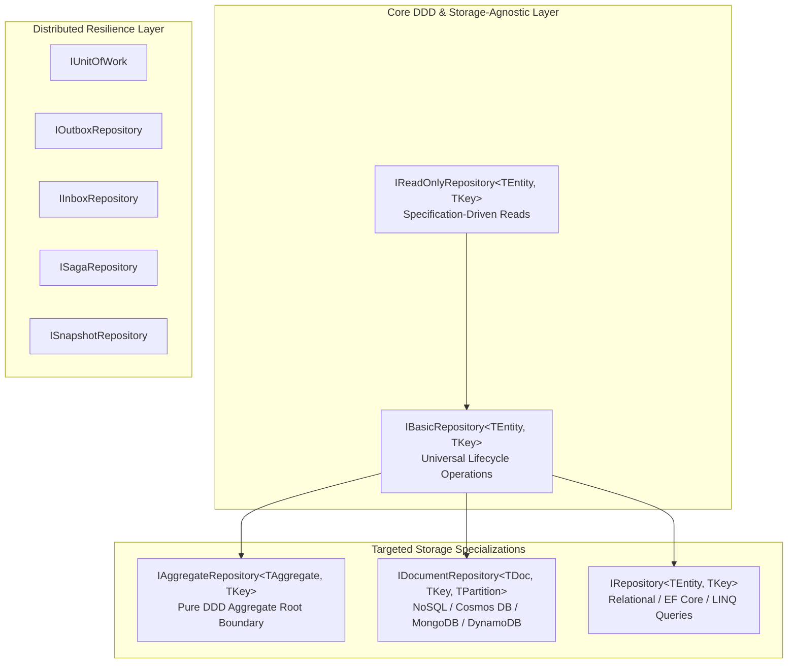

# Aarkam.DDD.Repositories

[](https://www.nuget.org/packages/Aarkam.DDD.Repositories/)
[](https://www.nuget.org/packages/Aarkam.DDD.Repositories/)
[](https://github.com/melhelbawi/Aarkam.DDD.Repositories/blob/main/LICENSE)
[](https://dotnet.microsoft.com/)
[](https://learn.microsoft.com/en-us/dotnet/core/deploying/native-aot/)
[](https://github.com/melhelbawi/Aarkam.DDD.Repositories)

> **We are a unique, standalone, zero-dependency Domain & Persistence foundation crafted from the ground up for modern enterprise architecture.**

`Aarkam.DDD.Repositories` provides enterprise-grade, strongly typed repository, Unit of Work, transactional outbox/inbox, distributed saga, event-sourcing snapshot, and secure dynamic query abstractions for .NET applications. It decouples core business logic from concrete Object-Relational Mappers (such as Entity Framework Core, Marten, or Dapper) and NoSQL Document engines (such as Azure Cosmos DB, MongoDB, or Amazon DynamoDB) while guaranteeing complete transaction atomicity, resilient messaging, and Native AOT compatibility.

---

## 📑 Table of Contents

- [Executive Summary](#-executive-summary)
- [🚀 Key Features](#-key-features)
- [⚡ Native AOT & IL Trimming](#-native-aot--il-trimming)
- [🏗️ Architectural Overview & Repository Hierarchy](#️-architectural-overview--repository-hierarchy)
- [📦 Installation](#-installation)
- [📖 Core Abstractions & Usage Guide](#-core-abstractions--usage-guide)
  - [1. Pure DDD Aggregate Root Repositories (`IAggregateRepository<TAggregate, TKey>`)](#1-pure-ddd-aggregate-root-repositories-iaggregaterepositorytaggregate-tkey)
  - [2. NoSQL & Document Database Repositories (`IDocumentRepository<TDocument, TKey, TPartitionKey>`)](#2-nosql--document-database-repositories-idocumentrepositorytdocument-tkey-tpartitionkey)
  - [3. Store-Agnostic Basic Repositories (`IBasicRepository<TEntity, TKey>`)](#3-store-agnostic-basic-repositories-ibasicrepositorytentity-tkey)
  - [4. Relational & LINQ Repositories (`IRepository<TEntity, TKey>`)](#4-relational--linq-repositories-irepositorytentity-tkey)
  - [5. Unit of Work Pattern (`IUnitOfWork`)](#5-unit-of-work-pattern-iunitofwork)
  - [6. Transactional Outbox Pattern (`IOutboxRepository`)](#6-transactional-outbox-pattern-ioutboxrepository)
  - [7. Idempotent Consumer Inbox Pattern (`IInboxRepository`)](#7-idempotent-consumer-inbox-pattern-iinboxrepository)
  - [8. Distributed Saga State Management (`ISagaRepository`)](#8-distributed-saga-state-management-isagarepository)
  - [9. Event Sourcing Snapshots (`ISnapshotRepository`)](#9-event-sourcing-snapshots-isnapshotrepository)
  - [10. Secure Dynamic Querying & Filtering (`AddFilter`, `AddSearch`)](#10-secure-dynamic-querying--filtering-addfilter-addsearch)
  - [11. Unified Result Models with DomainException (`ResultModel`, `PagedResult<T>`)](#11-unified-result-models-with-domainexception-resultmodel-pagedresultt)
- [🛡️ Security Best Practices](#️-security-best-practices)
- [👥 Authors & Maintainers](#-authors--maintainers)
- [📄 License](#-license)

---

## 📋 Executive Summary

In enterprise Domain-Driven Design (DDD), persistence must serve the domain model—never dictate it. Complex cloud-native architectures require clear boundaries between domain behavior and database operations, consistent transaction management across multiple aggregates, and resilient messaging patterns that withstand distributed network partitions.

`Aarkam.DDD.Repositories` delivers a pure, decoupled abstraction suite that eliminates boilerplate data access code and enforces industry best practices:

- **Storage-Agnostic Core**: First-class support for both Relational stores (PostgreSQL, SQL Server, MySQL) and NoSQL Document engines (Azure Cosmos DB, MongoDB, DynamoDB, RavenDB).
- **Strict Aggregate Roots**: Guarantees compile-time safety so repositories only manage Aggregate Roots (`IAggregateRoot`), preventing external leaks into child entities.
- **Partition-Aware NoSQL Contracts**: First-class support for Partition Keys ($O(1)$ point-reads), Upserts, ETags (optimistic concurrency), and bulk ingestion.
- **Transactional Consistency**: Coordinates changes across multiple aggregates within a single Unit of Work boundary, safely deferring domain event dispatching until after physical commit.
- **Guaranteed At-Least-Once Delivery**: Native Outbox abstractions permanently resolve dual-write vulnerabilities between relational databases and message brokers.
- **Idempotency Out of the Box**: Inbox abstractions guarantee exactly-once processing semantics for consumers handling messages from distributed brokers (RabbitMQ, Kafka, Azure Service Bus).
- **High-Performance Dynamic Queries**: Secure, whitelisted LINQ expression builders protect APIs from SQL injection, unauthorized property probing, and denial-of-service memory allocations.

---

## 🚀 Key Features

- **Store-Agnostic Abstraction Hierarchy**:
  - `IReadOnlyRepository<TEntity, TKey>`: Pure specification-driven query and retrieval without ORM leaks.
  - `IBasicRepository<TEntity, TKey>`: Universal asynchronous persistence operations.
  - `IAggregateRepository<TAggregate, TKey>`: Compile-time guarded DDD aggregate root persistence.
  - `IDocumentRepository<TDocument, TKey, TPartitionKey>`: Partition-aware NoSQL document store operations.
  - `IRepository<TEntity, TKey>`: Relational LINQ queryables and eager-loading navigation helpers.
- **Unit of Work (`IUnitOfWork`)**: Supports both relational database transactions and document-based session transactions (e.g., MongoDB ClientSession, Cosmos DB transactional batches).
- **Distributed Resilience**: Built-in transactional outbox (`IOutboxRepository`), idempotent consumer inbox (`IInboxRepository`), and saga coordinator (`ISagaRepository`).
- **Event Sourcing Optimization**: Aggregate snapshot repository (`ISnapshotRepository`) for fast aggregate rehydration.
- **Whitelisted Dynamic Query Engine**: Extensions (`AddFilter`, `AddSearch`, `AddSorting`, `UsePaging`) that convert client DTOs into secure expressions with fail-closed security.
- **Standardized Result Models**: Full integration with `DomainException` carrying `ErrorCode`, `Severity` (`ExceptionSeverity`), and contextual `Details`.
- **Zero Third-Party Dependencies**: Pure .NET contracts; no coupling to EF Core, Dapper, MassTransit, MediatR, or MongoDB drivers.

---

## ⚡ Native AOT & IL Trimming

`Aarkam.DDD.Repositories` is built from the ground up for modern .NET cloud runtimes with full ahead-of-time (AOT) compilation and assembly trimming support:

- **Zero Dynamic Code Generation in Core Abstractions**: All interfaces and contracts use strictly analyzed generic constraints compatible with `PublishAot=true`.
- **Pre-Trimming Annotations**: Validated across `.NET 8.0` and `.NET 10.0` with `IsAotCompatible=true`.
- **Lightweight Footprint**: Zero reflection emitted during standard aggregate persistence and query dispatching.

---

## 🏗️ Architectural Overview & Repository Hierarchy



---

## 📦 Installation

Install version `1.0.1` via .NET CLI:

```bash
dotnet add package Aarkam.DDD.Repositories --version 1.0.1
```

Or using the Package Manager Console in Visual Studio:

```powershell
Install-Package Aarkam.DDD.Repositories -Version 1.0.1
```

Or add the package reference directly to your `.csproj`:

```xml
<PackageReference Include="Aarkam.DDD.Repositories" Version="1.0.1" />
```

### 🧩 Ecosystem Packages

| Package | Description | Target Engines |
|:---|:---|:---|
| **[`Aarkam.DDD.Repositories`](https://www.nuget.org/packages/Aarkam.DDD.Repositories/)** | Core DDD repository abstractions, lean Unit of Work, Outbox/Inbox, Sagas, and Snapshots. | Storage-Agnostic |
| **[`Aarkam.DDD.Repositories.Sql`](https://www.nuget.org/packages/Aarkam.DDD.Repositories.Sql/)** | Production-ready EF Core implementations with ModelBuilder & DI extensions. | PostgreSQL, SQL Server, SQLite, MySQL, Oracle |

---

## 📖 Core Abstractions & Usage Guide

### 1. Pure DDD Aggregate Root Repositories (`IAggregateRepository<TAggregate, TKey>`)

In pure DDD, child entities must never have their own repository. Restricting persistence to `IAggregateRepository` guarantees that business invariants are maintained through the aggregate root:

```csharp
using Aarkam.Domain.Repositories;

public class OrderCommandHandler
{
    private readonly IAggregateRepository<Order, Guid> _orderRepository;

    public OrderCommandHandler(IAggregateRepository<Order, Guid> orderRepository)
    {
        _orderRepository = orderRepository;
    }

    public async Task HandleAddLineAsync(Guid orderId, AddOrderLineDto dto, CancellationToken cancellationToken)
    {
        var order = await _orderRepository.GetByIdAsync(orderId, cancellationToken);
        if (order is null) throw new EntityNotFoundException(typeof(Order), orderId);

        // Business invariants are guarded strictly inside the Aggregate Root
        order.AddLineItem(dto.ProductId, dto.Quantity, dto.UnitPrice);

        // In pure DDD, SaveAsync atomically commits aggregate state and dispatches/enqueues domain events:
        await _orderRepository.SaveAsync(order, cancellationToken);
    }
}
```

---

### 2. NoSQL & Document Database Repositories (`IDocumentRepository<TDocument, TKey, TPartitionKey>`)

Tailored for distributed document databases (Azure Cosmos DB, MongoDB, DynamoDB) requiring partition-key routing, atomic upsert, and ETag optimistic concurrency:

```csharp
using Aarkam.Domain.Repositories;

public class CustomerProfileService
{
    private readonly IDocumentRepository<CustomerProfile, Guid, string> _customerDocRepo;

    public CustomerProfileService(IDocumentRepository<CustomerProfile, Guid, string> customerDocRepo)
    {
        _customerDocRepo = customerDocRepo;
    }

    public async Task<CustomerProfile?> GetCustomerAsync(Guid customerId, string countryCode, CancellationToken ct)
    {
        // Point-read directly to the physical partition: O(1) efficiency (1 RU in Cosmos DB)
        return await _customerDocRepo.GetByIdAsync(customerId, partitionKey: countryCode, ct);
    }

    public async Task UpsertCustomerAsync(CustomerProfile profile, CancellationToken ct)
    {
        // Native NoSQL Upsert: insert if new, replace if exists
        await _customerDocRepo.UpsertAsync(profile, partitionKey: profile.CountryCode, ct);
    }

    public async Task UpdateWithConcurrencyAsync(CustomerProfile profile, string eTag, CancellationToken ct)
    {
        // Safe optimistic concurrency check with HTTP ETag
        await _customerDocRepo.ReplaceAsync(profile, eTag, partitionKey: profile.CountryCode, ct);
    }
}
```

---

### 3. Store-Agnostic Basic Repositories (`IBasicRepository<TEntity, TKey>`)

Use `IBasicRepository` when writing storage-neutral application services that operate equally well on relational databases, NoSQL engines, or in-memory caches:

```csharp
public class ProductService
{
    private readonly IBasicRepository<Product, int> _productRepository;

    public ProductService(IBasicRepository<Product, int> productRepository)
    {
        _productRepository = productRepository;
    }

    public async Task<IReadOnlyList<Product>> GetFeaturedProductsAsync(CancellationToken ct)
    {
        // Encapsulate query logic inside a reusable Specification
        var spec = new FeaturedProductsSpecification();
        return await _productRepository.ListAsync(spec, ct);
    }
}
```

---

### 4. Relational & LINQ Repositories (`IRepository<TEntity, TKey>`)

When working with Entity Framework Core or relational databases, `IRepository<TEntity, TKey>` combines basic persistence with LINQ querying and eager-loading navigation:

```csharp
public async Task<List<Order>> GetActiveOrdersAsync(Guid customerId, CancellationToken cancellationToken)
{
    return await _orderRepository.ToListAsync(
        order => order.CustomerId == customerId && !order.IsCancelled, 
        cancellationToken);
}
```

---

### 5. Lean Transaction Commit Boundary (`IUnitOfWork`)

Acts purely as a physical transaction coordinator without the Service Locator anti-pattern. Repositories are injected explicitly via constructor injection:

```csharp
public class OrderCheckoutService
{
    private readonly IRepository<Order, Guid> _orderRepo;
    private readonly IOutboxRepository _outboxRepo;
    private readonly IUnitOfWork _unitOfWork;

    public OrderCheckoutService(
        IRepository<Order, Guid> orderRepo,
        IOutboxRepository outboxRepo,
        IUnitOfWork unitOfWork)
    {
        _orderRepo = orderRepo;
        _outboxRepo = outboxRepo;
        _unitOfWork = unitOfWork;
    }

    public async Task ProcessCheckoutAsync(CheckoutCommand command, CancellationToken cancellationToken)
    {
        await _unitOfWork.BeginTransactionAsync(cancellationToken);

        try
        {
            var order = new Order(Guid.NewGuid(), command.CustomerId, command.Amount);
            await _orderRepo.AddAsync(order, cancellationToken);

            var outboxMessage = new OutboxMessage(Guid.NewGuid(), "OrderPlaced", JsonSerializer.Serialize(order));
            await _outboxRepo.AddAsync(outboxMessage, cancellationToken);

            // Commit both domain state and outbox envelope atomically
            await _unitOfWork.SaveChangesAsync(cancellationToken);
            await _unitOfWork.CommitTransactionAsync(cancellationToken);
        }
        catch
        {
            await _unitOfWork.RollbackTransactionAsync(cancellationToken);
            throw;
        }
    }
}
```

---

### 6. Transactional Outbox Pattern (`IOutboxRepository`)

Resolves the dual-write problem by persisting outbox messages in the same transaction as domain state mutations:

```csharp
public async Task PlaceOrderWithOutboxAsync(Order order, CancellationToken cancellationToken)
{
    var orderPlacedEvent = new OrderPlacedIntegrationEvent(order.Id, order.TotalAmount);
    
    var outboxMessage = new OutboxMessage(
        Guid.NewGuid(),
        orderPlacedEvent.GetType().AssemblyQualifiedName!,
        JsonSerializer.Serialize(orderPlacedEvent),
        correlationId: Guid.NewGuid());

    await _orderRepository.AddAsync(order, cancellationToken);
    await _outboxRepository.AddAsync(outboxMessage, cancellationToken);
    await _unitOfWork.SaveChangesAsync(cancellationToken);
}
```

---

### 7. Idempotent Consumer Inbox Pattern (`IInboxRepository`)

Guarantees exactly-once processing semantics for consumers handling messages from brokers (RabbitMQ, Kafka, Azure Service Bus):

```csharp
public async Task HandleOrderPaymentReceivedAsync(OrderPaymentIntegrationEvent @event, CancellationToken cancellationToken)
{
    const string consumerName = nameof(HandleOrderPaymentReceivedAsync);

    if (await _inboxRepository.HasBeenProcessedAsync(@event.EventId, consumerName, cancellationToken))
    {
        return; // Message already applied; safely acknowledge and exit
    }

    var order = await _orderRepository.GetByIdAsync(@event.OrderId, cancellationToken);
    order?.MarkAsPaid();

    var inboxRecord = new InboxMessage(@event.EventId, @event.GetType().Name, consumerName);
    await _inboxRepository.RecordAsync(inboxRecord, cancellationToken);

    await _unitOfWork.SaveChangesAsync(cancellationToken);
}
```

---

### 8. Distributed Saga State Management (`ISagaRepository`)

Persists state machines coordinating distributed transactions across bounded contexts:

```csharp
public async Task HandleSagaStepAsync(Guid sagaId, PaymentCompletedEvent paymentEvent, CancellationToken cancellationToken)
{
    var saga = await _sagaRepository.LoadAsync<OrderFulfillmentSaga, OrderFulfillmentSagaData>(sagaId, cancellationToken);
    if (saga is null) throw new InvalidOperationException($"Saga '{sagaId}' not found.");

    saga.RecordPaymentSuccess(paymentEvent.TransactionId);

    await _sagaRepository.SaveAsync<OrderFulfillmentSaga, OrderFulfillmentSagaData>(saga, cancellationToken);
}
```

---

### 9. Event Sourcing Snapshots (`ISnapshotRepository`)

Accelerates aggregate reconstitution by persisting periodic state checkpoints:

```csharp
public async Task<OrderAggregate> RehydrateAggregateAsync(Guid orderId, CancellationToken cancellationToken)
{
    var snapshot = await _snapshotRepository.GetLatestAsync(orderId, cancellationToken);

    OrderAggregate aggregate;
    long fromVersion = 0;

    if (snapshot is not null)
    {
        aggregate = JsonSerializer.Deserialize<OrderAggregate>(snapshot.State)!;
        fromVersion = snapshot.Version;
    }
    else
    {
        aggregate = new OrderAggregate(orderId);
    }

    var deltaEvents = await _eventStore.GetEventsAfterVersionAsync(orderId, fromVersion, cancellationToken);
    aggregate.ReplayEvents(deltaEvents);

    return aggregate;
}
```

---

### 10. Secure Dynamic Querying & Filtering (`AddFilter`, `AddSearch`)

Provides secure, whitelisted dynamic LINQ queries directly from client DTOs without SQL injection or sensitive property exposure:

```csharp
[HttpGet("search")]
public async Task<IActionResult> SearchOrdersAsync([FromQuery] PaginationModel model)
{
    var allowedProperties = new[] { "OrderNumber", "CustomerId", "TotalAmount", "CreationTime" };

    var query = _orderRepository.AsQueryable()
        .AddFilter(model.Filters, FilterOperation.And, allowedProperties)
        .AddSearch(model.SearchExpression, allowedProperties)
        .AddSorting(model.SortingField, allowedProperties);

    var pagedResult = await query.ToPagedResultAsync(model.PagingOptions);

    return Ok(ResultModel<PagedResult<Order>>.Success(pagedResult));
}
```

---

### 11. Unified Result Models with DomainException (`ResultModel`, `PagedResult<T>`)

Seamlessly converts domain failures into machine-readable API error envelopes:

```csharp
// Direct conversion from a DomainException
try
{
    order.Cancel();
}
catch (DomainException ex)
{
    return ResultModel.FromException(ex);
    // Returns:
    // IsSuccess: false
    // ErrorCode: "ERR_ORDER_ALREADY_SHIPPED"
    // Severity: ExceptionSeverity.Error
    // Details: { "ShippedDate": "2026-10-24" }
}

// Successful response with data
return ResultModel<OrderDto>.Success(orderDto);
```

---

## 🛡️ Security Best Practices

1. **Property Whitelisting (Fail-Closed)**: Always supply `allowedProperties` when calling `AddFilter`, `AddSearch`, or `AddSorting`. If an empty whitelist or unmapped property is provided, the query rejects the filter by default, shielding sensitive entity properties (e.g., `PasswordHash`, `ApiKey`, `TenantId`) from exposure.
2. **Input Value Sanitization**: `QeryableFilterExtension.MaxValueLength` (default `500` characters) automatically blocks payload flood attacks and excessive memory allocations.
3. **ORM Parameterization**: All filter values are constructed through native `Expression.Constant` parameters, ensuring the underlying ORM parameterizes all SQL queries to prevent SQL injection.

---

## 👥 Authors & Maintainers

- **Eng. Mohamed ElHelbawi** ([@melhelbawi](https://github.com/melhelbawi))
- **Aarkam Team** ([aarkam.io](https://aarkam.io/))

Repository: [https://github.com/melhelbawi/Aarkam.DDD.Repositories](https://github.com/melhelbawi/Aarkam.DDD.Repositories)  
NuGet: [https://www.nuget.org/packages/Aarkam.DDD.Repositories/](https://www.nuget.org/packages/Aarkam.DDD.Repositories/)

---

## 📄 License

This project is licensed under the **[MIT License](https://github.com/melhelbawi/Aarkam.DDD.Repositories/blob/main/LICENSE)**.

```text
Copyright © 2026 Aarkam & Mohamed Elhelbawi. All rights reserved.
```
