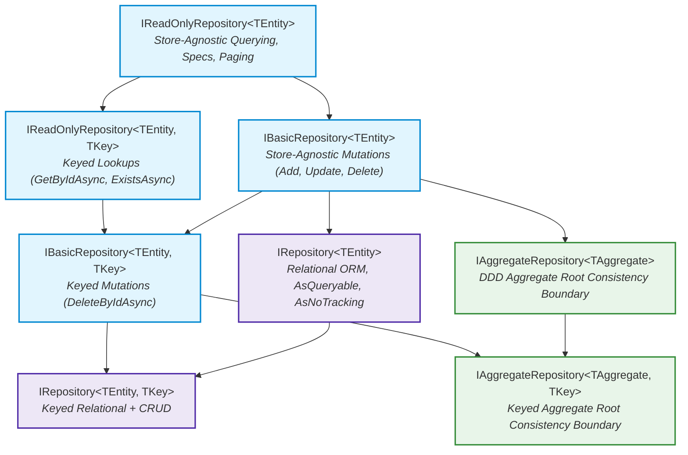

# Release Notes: Aarkam.DDD.Repositories & Aarkam.DDD.Repositories.Sql v1.0.3

**Release Date:** October 27, 2026  
**Version:** `1.0.3`  
**License:** MIT  
**Authors:** Eng. Mohamed ElHelbawi, Aarkam Team  
**Repository:** [https://github.com/melhelbawi/Aarkam.DDD.Repositories](https://github.com/melhelbawi/Aarkam.DDD.Repositories)  
**Package Output Location:** `C:\Nuget\`

---

## 📑 Table of Contents

- [1. Executive Summary](#1-executive-summary)
- [2. Breaking Changes & Compatibility](#2-breaking-changes--compatibility)
- [3. Core Architecture & 1-Generic Abstractions](#3-core-architecture--1-generic-abstractions)
- [4. Repository Varieties in Aarkam.DDD.Repositories.Sql](#4-repository-varieties-in-aarkamdddrepositoriessql)
- [5. Pure DDD Aggregate Lifecycle & Transactional Outbox](#5-pure-ddd-aggregate-lifecycle--transactional-outbox)
- [6. Dependency Injection Modernization & Multi-DbContext](#6-dependency-injection-modernization--multi-dbcontext)
- [7. Code Examples & Usage Patterns](#7-code-examples--usage-patterns)
- [8. Verification & Test Metrics](#8-verification--test-metrics)
- [9. Package Manifest & File Locations](#9-package-manifest--file-locations)

---

## 1. Executive Summary

Version `1.0.3` represents an essential architectural milestone for the Aarkam persistence ecosystem. It addresses critical interface-to-implementation contract gaps and delivers:

1. **Complete 1-Generic Abstractions**: Entities with composite, natural, or shadow keys now have full first-class access to store-agnostic reading (`IReadOnlyRepository<TEntity>`), mutations (`IBasicRepository<TEntity>`), and relational LINQ operations (`IRepository<TEntity>`).
2. **Complete Variety Matrix**: Strongly-typed DbContext bindings for all repository abstractions, facilitating seamless multi-tenancy, bounded contexts, and modular monoliths.
3. **Pure DDD Aggregate Root Invariant Commit**: Aggregate root `SaveAsync` now automatically extracts uncommitted domain events, stages them to the Transactional Outbox, and clears the uncommitted event stream after a successful physical commit.
4. **Enhanced Dependency Injection**: Scope-forwarding for Unit of Work and registration of all open and closed generic varieties.

---

## 2. Breaking Changes & Compatibility

- **Breaking Changes:** **NONE.** `v1.0.3` is 100% backward compatible with `v1.0.2`, `v1.0.1`, and `v1.0.0`.
- **Target Frameworks:**
  - `netstandard2.1`
  - `.NET 6.0`
  - `.NET 7.0`
  - `.NET 8.0`
  - `.NET 9.0`
  - `.NET 10.0`
  - `.NET 11.0`
- **Native AOT & Trimming:** Fully supported with zero IL warnings across modern .NET runtimes.

---

## 3. Core Architecture & 1-Generic Abstractions

In prior versions, store-agnostic abstractions were restricted to entities having a single scalar key `TKey`. In `v1.0.3`, the hierarchy has been refactored into a layered, unifiable design:



### Newly Added Contracts in `Aarkam.DDD.Repositories`:
- `IReadOnlyRepository<TEntity>`: Exposes `FindAsync`, `ListAsync`, `CountAsync`, and `GetPagedAsync`.
- `IBasicRepository<TEntity>`: Exposes `AddAsync`, `AddRangeAsync`, `UpdateAsync`, `UpdateRangeAsync`, `DeleteAsync`, and `DeleteRangeAsync`.
- `IAggregateRepository<TAggregate>`: Exposes atomic `SaveAsync(TAggregate aggregate)` for aggregate roots.
- `IUnitOfWork<TContext>`: Strongly typed Unit of Work interface disambiguating persistence contexts.

---

## 4. Repository Varieties in `Aarkam.DDD.Repositories.Sql`

`Aarkam.DDD.Repositories.Sql` now supplies every combination of entity arity and context binding:

| Interface | Default Implementation | Context-Bound Implementation |
| :--- | :--- | :--- |
| `IRepository<TEntity>` | `EfCoreRepository<TEntity>` | `EfCoreContextRepository<TEntity, TDbContext>` |
| `IRepository<TEntity, TKey>` | `EfCoreRepository<TEntity, TKey>` | `EfCoreRepository<TEntity, TKey, TDbContext>` |
| `IAggregateRepository<TAggregate>` | `EfCoreAggregateRepository<TAggregate>` | `EfCoreContextAggregateRepository<TAggregate, TDbContext>` |
| `IAggregateRepository<TAggregate, TKey>` | `EfCoreAggregateRepository<TAggregate, TKey>` | `EfCoreAggregateRepository<TAggregate, TKey, TDbContext>` |
| `IUnitOfWork` | `EfCoreUnitOfWork` | `EfCoreUnitOfWork<TDbContext>` |
| `IOutboxRepository<TMessage>` | `EfCoreOutboxRepository<TMessage>` | `EfCoreOutboxRepository<TMessage, TDbContext>` |
| `IInboxRepository` | `EfCoreInboxRepository` | `EfCoreInboxRepository<TDbContext>` |
| `ISagaRepository` | `EfCoreSagaRepository` | `EfCoreSagaRepository<TDbContext>` |
| `ISnapshotRepository<TAggregate>` | `EfCoreSnapshotRepository<TAggregate>` | `EfCoreSnapshotRepository<TAggregate, TDbContext>` |

---

## 5. Pure DDD Aggregate Lifecycle & Transactional Outbox

`EfCoreAggregateRepository.SaveAsync` now provides full out-of-the-box domain event dispatching and change tracking protection:

```
  Aggregate Root Mutation (e.g. order.Cancel())
                  │
                  ▼
          SaveAsync(order)
                  │
       ┌──────────┴──────────┐
       ▼                     ▼
 Change Tracking      Event Extraction
 Attach / Update     (IHasDomainEvents)
       │                     │
       ▼                     ▼
  EF Core State     Stage to Outbox Repository
       │                     │
       └──────────┬──────────┘
                  ▼
    SaveChangesAsync() [Single Atomic Transaction]
                  │
                  ▼
    MarkEventsAsCommitted() [Clean In-Memory Stream]
```

1. **Intelligent Upsert Resolution**: Dynamically reads primary key metadata from EF Core's model to prevent `DbUpdateConcurrencyException` when handling detached aggregates with pre-assigned identifiers.
2. **Domain Event Interception**: When an aggregate implements `IHasDomainEvents`, uncommitted events from `GetChanges()` are serialized and staged into the transactional outbox table before committing.
3. **Atomic Consistency**: The aggregate state changes and outbox messages commit in a single database roundtrip.
4. **Lifecycle Finalization**: `MarkEventsAsCommitted()` is called immediately following physical commit, leaving the aggregate in a clean state.

---

## 6. Dependency Injection Modernization & Multi-DbContext

`services.AddAarkamSqlRepositories<TDbContext>()` has been upgraded to resolve multi-context collisions and provide clean instance lifetimes:

```csharp
// Program.cs
var services = new ServiceCollection();

// Register multiple DbContexts cleanly:
services.AddDbContext<OrderingDbContext>(...);
services.AddDbContext<CatalogDbContext>(...);

services.AddAarkamSqlRepositories<OrderingDbContext>();
services.AddAarkamSqlRepositories<CatalogDbContext>();
```

### DI Registration Features:
- **Instance Forwarding**: Resolving `IUnitOfWork` and `IUnitOfWork<TDbContext>` returns the exact same scoped instance of `EfCoreUnitOfWork<TDbContext>`.
- **Open-Generic Mappings**: Automatically registers `IReadOnlyRepository<>`, `IBasicRepository<>`, `IRepository<>`, and `IAggregateRepository<>`.
- **Direct Context Resolvers**: Resolves context-bound repositories directly (e.g. `EfCoreRepository<Order, Guid, OrderingDbContext>`).

---

## 7. Code Examples & Usage Patterns

### A. Non-Keyed Entity Repository
```csharp
public class OrderItemHandler
{
    private readonly IRepository<OrderItem> _itemRepo;

    public OrderItemHandler(IRepository<OrderItem> itemRepo)
    {
        _itemRepo = itemRepo;
    }

    public async Task<IReadOnlyList<OrderItem>> GetHighValueItemsAsync()
    {
        // Now fully accessible on 1-generic IRepository<TEntity>!
        return await _itemRepo.ListAsync(x => x.UnitPrice > 100m);
    }
}
```

### B. Pure DDD Aggregate Persistence with Events
```csharp
public class OrderCommandHandler
{
    private readonly IAggregateRepository<Order, Guid> _orderRepo;

    public OrderCommandHandler(IAggregateRepository<Order, Guid> orderRepo)
    {
        _orderRepo = orderRepo;
    }

    public async Task CancelOrderAsync(Guid orderId)
    {
        var order = await _orderRepo.GetByIdAsync(orderId);
        if (order == null) throw new EntityNotFoundException(typeof(Order), orderId);

        // Raises OrderCancelledDomainEvent internally
        order.Cancel();

        // Atomically persists order state, stages event to Outbox, and clears uncommitted events!
        await _orderRepo.SaveAsync(order);
    }
}
```

---

## 8. Verification & Test Metrics

Both packages have been validated against our automated test suite across all supported runtime targets:

| Test Project | Runtimes Tested | Total Tests | Status |
| :--- | :--- | :---: | :---: |
| **Aarkam.DDD.Repositories.Tests** | `.NET Standard 2.1` to `.NET 11.0` | **373** | ✅ Passed |
| **Aarkam.DDD.Repositories.Sql.Tests** | `.NET 6.0` to `.NET 11.0` | **67** | ✅ Passed |
| **Total Test Suite** | | **440** | **✅ 100% Passed (0 Warnings)** |

---

## 9. Package Manifest & File Locations

The release packages have been compiled in `Release` configuration and published to `C:\Nuget`:

```
C:\Nuget\
├── Aarkam.DDD.Repositories.1.0.3.nupkg
├── Aarkam.DDD.Repositories.1.0.3.snupkg
├── Aarkam.DDD.Repositories.Sql.1.0.3.nupkg
└── Aarkam.DDD.Repositories.Sql.1.0.3.snupkg
```
