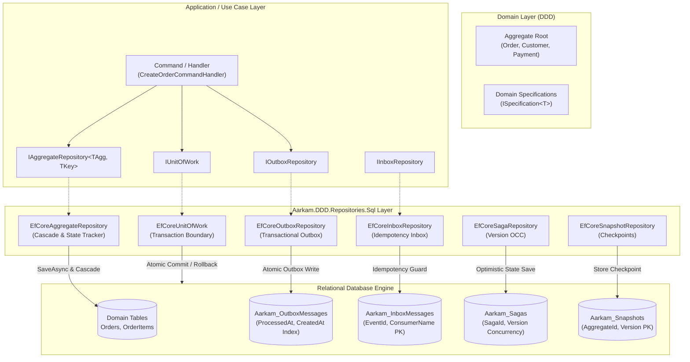

# Aarkam.DDD.Repositories.Sql

[](https://www.nuget.org/packages/Aarkam.DDD.Repositories.Sql/)
[](https://www.nuget.org/packages/Aarkam.DDD.Repositories.Sql/)
[](https://github.com/melhelbawi/Aarkam.DDD.Repositories/blob/main/LICENSE)
[](https://dotnet.microsoft.com/)
[](https://learn.microsoft.com/en-us/ef/core/)
[](https://learn.microsoft.com/en-us/dotnet/core/deploying/native-aot/)
[](https://github.com/melhelbawi/Aarkam.DDD.Repositories)

> **Enterprise-grade, high-performance Entity Framework Core implementation suite for pure Domain-Driven Design (DDD) architectures, distributed microservices, and mission-critical relational persistence.**

`Aarkam.DDD.Repositories.Sql` bridges the gap between pure Domain-Driven Design and relational database persistence. It delivers production-hardened, Native AOT-ready implementations of the pure repository contracts defined in [`Aarkam.DDD.Repositories`](https://www.nuget.org/packages/Aarkam.DDD.Repositories/), providing compile-time guarded Aggregate Root persistence, a lean Unit of Work transaction boundary, and built-in distributed resilience patterns (Transactional Outbox, Idempotent Consumer Inbox, Distributed Saga Persistence, and Event Sourcing Snapshots).

Compatible with all leading relational database engines powered by Entity Framework Core: **PostgreSQL**, **Microsoft SQL Server**, **MySQL / MariaDB**, **SQLite**, and **Oracle**.

---

## 📑 Table of Contents

- [Executive Summary](#-executive-summary)
- [🌟 Key Architectural Highlights](#-key-architectural-highlights)
- [🏗️ System Architecture & Relational Flow](#️-system-architecture--relational-flow)
- [📦 Supported Database Providers](#-supported-database-providers)
- [🎯 Multi-Targeting & Package Matrix](#-multi-targeting--package-matrix)
- [🚀 Quick Start Installation](#-quick-start-installation)
- [⚙️ Setup & Configuration](#️-setup--configuration)
  - [1. Configure Model Schema & Messaging Tables](#1-configure-model-schema--messaging-tables)
  - [2. Register Services with Dependency Injection](#2-register-services-with-dependency-injection)
- [📖 Comprehensive Usage Guides & Real-World Patterns](#-comprehensive-usage-guides--real-world-patterns)
  - [Pattern 1: Pure Aggregate Root Consistency (`IAggregateRepository<TAggregate, TKey>`)](#pattern-1-pure-aggregate-root-consistency-iaggregaterepositorytaggregate-tkey)
  - [Pattern 2: Lean Unit of Work & Transaction Boundaries (`IUnitOfWork`)](#pattern-2-lean-unit-of-work--transaction-boundaries-iunitofwork)
  - [Pattern 3: Guaranteed Message Delivery with Transactional Outbox (`IOutboxRepository`)](#pattern-3-guaranteed-message-delivery-with-transactional-outbox-ioutboxrepository)
  - [Pattern 4: Idempotent Consumer with Deduplication Inbox (`IInboxRepository`)](#pattern-4-idempotent-consumer-with-deduplication-inbox-iinboxrepository)
  - [Pattern 5: Distributed Saga Orchestration & Optimistic Concurrency (`ISagaRepository`)](#pattern-5-distributed-saga-orchestration--optimistic-concurrency-isagarepository)
  - [Pattern 6: Event Sourcing Snapshots with Automated Pruning (`ISnapshotRepository`)](#pattern-6-event-sourcing-snapshots-with-automated-pruning-isnapshotrepository)
  - [Pattern 7: Advanced Specification-Based Queries & Pagination (`ISpecification<T>`)](#pattern-7-advanced-specification-based-queries--pagination-ispecificationt)
- [⚡ High-Performance & Production Best Practices](#-high-performance--production-best-practices)
- [🧪 Testing Strategy: In-Memory & SQLite](#-testing-strategy-in-memory--sqlite)
- [👥 Authors & Maintainers](#-authors--maintainers)
- [📄 License](#-license)

---

## 📋 Executive Summary

Relational databases remain the backbone of enterprise data infrastructure. However, modern Domain-Driven Design (DDD) and cloud-native microservices introduce severe challenges when paired with traditional Object-Relational Mappers (ORMs):

1. **Leaky Consistency Boundaries**: Developers frequently bypass Aggregate Roots by querying and mutating child entities directly, breaking business invariants and causing corrupt domain states.
2. **Dual-Write Vulnerabilities**: Updating a database record while simultaneously publishing an event to a message broker (RabbitMQ, Kafka, Azure Service Bus) without distributed two-phase commits inevitably leads to message loss or state desynchronization.
3. **Leaky Service Locator Anti-Patterns**: Monolithic "Generic Unit of Work" implementations that expose every repository via getters turn persistence layers into anti-patterns that bloat memory and impede modularity.
4. **Duplicate Consumer Processing**: Distributed networks cause retries, which result in duplicate events that execute duplicate side-effects (e.g. charging a credit card twice).
5. **Multi-Target Incompatibility**: Modern microservices span multiple LTS and modern .NET runtimes, creating dependency conflicts when referencing mismatched EF Core and dependency injection libraries.

### How `Aarkam.DDD.Repositories.Sql` Resolves These Challenges

`Aarkam.DDD.Repositories.Sql` is engineered specifically to eliminate these risks:

- **Enforces DDD Aggregate Boundaries**: `EfCoreAggregateRepository<TAggregate, TKey>` restricts write persistence strictly to Aggregate Roots (`IAggregateRoot<TKey>`). Child entities are persisted and cascaded exclusively through their root.
- **Lean Transaction Coordinator**: `EfCoreUnitOfWork` provides clean transaction control (`BeginTransactionAsync`, `CommitTransactionAsync`, `RollbackTransactionAsync`) without exposing generic repositories or acting as a service locator.
- **Zero-Loss Transactional Outbox**: Stores integration events into the identical relational database transaction alongside business aggregate changes. Dedicated outbox tables and polling queries guarantee at-least-once event dispatching.
- **Strict Idempotency Inbox**: Automatically verifies unique event delivery with composite primary keys (`EventId`, `ConsumerName`), guaranteeing exactly-once consumer execution semantics.
- **Optimistic Concurrency Distributed Sagas**: Persists distributed workflow checkpoints with automatic version-based concurrency violation checks (`DbUpdateConcurrencyException`).
- **Complete .NET Target Coverage**: Ships first-class, warning-free native packages for `.NET 6.0`, `7.0`, `8.0`, `9.0`, `10.0`, and `11.0` with exact EF Core dependency alignment.

---

## 🌟 Key Architectural Highlights

- **Pure DDD Separation**: Complete decoupling between Domain invariants, Application use cases, and Relational database schemas.
- **Full Relational Engine Compatibility**: Validated on SQL Server, PostgreSQL, SQLite, MySQL, and Oracle.
- **Native AOT & Trimming Compliant**: Zero emit-based reflection during standard persistence; fully compatible with `PublishAot=true`.
- **High-Throughput Composite Indexing**: Out-of-the-box indexes designed specifically for ultra-fast Outbox queue polling, Saga timeout scanning, and Inbox deduplication checks.
- **Automatic State Detection**: `SaveAsync` seamlessly evaluates whether an aggregate is attached or detached from EF Core's ChangeTracker, transparently executing optimized `Add` or `Update` statements.
- **Strongly-Typed DbContext Variants**: Supports both open-generic implementations and strongly-bound `TDbContext` types for multi-context enterprise solutions.
- **Automated Retention Lifecycle**: Built-in batch cleanup methods for processed Outbox messages, acknowledged Inbox events, expired Sagas, and historical Snapshots.

---

## 🏗️ System Architecture & Relational Flow



---

## 📦 Supported Database Providers

`Aarkam.DDD.Repositories.Sql` operates cleanly over EF Core's `DbContext` and relational metadata abstractions, making it 100% database provider agnostic:

| Database Engine | Official EF Core Provider | Compatibility Status |
|:---|:---|:---:|
| **PostgreSQL** | `Npgsql.EntityFrameworkCore.PostgreSQL` | ✅ Verified Production |
| **Microsoft SQL Server** | `Microsoft.EntityFrameworkCore.SqlServer` | ✅ Verified Production |
| **MySQL / MariaDB** | `Pomelo.EntityFrameworkCore.MySql` | ✅ Verified Production |
| **SQLite** | `Microsoft.EntityFrameworkCore.Sqlite` | ✅ Verified Production |
| **Oracle** | `Oracle.EntityFrameworkCore` | ✅ Verified Production |
| **In-Memory (Unit Testing)** | `Microsoft.EntityFrameworkCore.InMemory` | ✅ Verified Testing |

---

## 🎯 Multi-Targeting & Package Matrix

To guarantee zero package downgrade warnings (`NU1605`) and avoid runtime binary incompatibilities, `Aarkam.DDD.Repositories.Sql` conditionally compiles and links against exact EF Core framework releases:

| Target Framework | Target Moniker | EF Core Relational Version | Microsoft Dependency Injection | Native AOT |
|:---|:---|:---|:---|:---:|
| **.NET 6.0 LTS** | `net6.0` | `6.0.36` | `8.0.0` | N/A |
| **.NET 7.0 STS** | `net7.0` | `7.0.20` | `8.0.0` | Supported |
| **.NET 8.0 LTS** | `net8.0` | `8.0.13` | `8.0.2` | Supported |
| **.NET 9.0 STS** | `net9.0` | `9.0.2` | `9.0.2` | Supported |
| **.NET 10.0 LTS** | `net10.0` | `10.0.13` | `10.0.13` | Supported |
| **.NET 11.0 Preview** | `net11.0` | `11.0.0-rc.2.26504.105` | `11.0.0-rc.2.26504.105` | Supported |

---

## 🚀 Quick Start Installation

Install the package via .NET CLI:

```bash
dotnet add package Aarkam.DDD.Repositories.Sql --version 1.0.1
```

Or via Package Manager Console:

```powershell
Install-Package Aarkam.DDD.Repositories.Sql -Version 1.0.1
```

Or reference directly in your `.csproj`:

```xml
<PackageReference Include="Aarkam.DDD.Repositories.Sql" Version="1.0.1" />
```

---

## ⚙️ Setup & Configuration

### 1. Configure Model Schema & Messaging Tables

In your application's `DbContext`, call `modelBuilder.ApplyAarkamSqlMessagingConfigurations()`. This automatically sets up optimized table structures, keys, and high-performance indexes for Outbox, Inbox, Saga, and Snapshot records:

```csharp
using Aarkam.DDD.Repositories.Sql.Configurations;
using Microsoft.EntityFrameworkCore;

public class ApplicationDbContext : DbContext
{
    public DbSet<Order> Orders => Set<Order>();
    public DbSet<OrderItem> OrderItems => Set<OrderItem>();

    public ApplicationDbContext(DbContextOptions<ApplicationDbContext> options) 
        : base(options) 
    { 
    }

    protected override void OnModelCreating(ModelBuilder modelBuilder)
    {
        base.OnModelCreating(modelBuilder);

        // 1. Configure your domain aggregate roots
        modelBuilder.Entity<Order>(b =>
        {
            b.HasKey(o => o.Id);
            b.Property(o => o.OrderNumber).IsRequired().HasMaxLength(50);
            b.Property(o => o.TotalAmount).HasPrecision(18, 2);
            
            // Cascade child items through aggregate root
            b.HasMany(o => o.Items)
             .WithOne()
             .HasForeignKey(i => i.OrderId)
             .OnDelete(DeleteBehavior.Cascade);

            b.Ignore(o => o.ExtraProperties);
        });

        // 2. Automatically register Aarkam Messaging tables & indexes:
        //    - Aarkam_OutboxMessages (with (ProcessedAt, CreatedAt) polling index)
        //    - Aarkam_InboxMessages (with (EventId, ConsumerName) composite key)
        //    - Aarkam_Sagas (with Version concurrency token & timeout index)
        //    - Aarkam_Snapshots (with (AggregateId, Version) composite key)
        modelBuilder.ApplyAarkamSqlMessagingConfigurations(schema: "messaging");
    }
}
```

### 2. Register Services with Dependency Injection

Register your database provider and then invoke `AddAarkamSqlRepositories<TDbContext>()` in `Program.cs`:

```csharp
using Aarkam.DDD.Repositories.Sql.DependencyInjection;
using Microsoft.EntityFrameworkCore;

var builder = WebApplication.CreateBuilder(args);

// Configure EF Core with PostgreSQL (or SQL Server / SQLite / MySQL)
builder.Services.AddDbContext<ApplicationDbContext>(options =>
    options.UseNpgsql(builder.Configuration.GetConnectionString("PostgresDatabase")));

// Register all Aarkam SQL repositories and transaction boundaries:
// - IUnitOfWork & EfCoreUnitOfWork<ApplicationDbContext>
// - IAggregateRepository<,> & EfCoreAggregateRepository<,>
// - IRepository<,>, IBasicRepository<,>, IReadOnlyRepository<,>
// - IOutboxRepository & EfCoreOutboxRepository
// - IInboxRepository & EfCoreInboxRepository
// - ISagaRepository & EfCoreSagaRepository
// - ISnapshotRepository & EfCoreSnapshotRepository
builder.Services.AddAarkamSqlRepositories<ApplicationDbContext>();

var app = builder.Build();
app.Run();
```

---

## 📖 Comprehensive Usage Guides & Real-World Patterns

### Pattern 1: Pure Aggregate Root Consistency (`IAggregateRepository<TAggregate, TKey>`)

In DDD, child entities (e.g. `OrderItem`) must never be modified or saved independently of their parent Aggregate Root (`Order`). The `EfCoreAggregateRepository` ensures invariants are maintained:

```csharp
using Aarkam.Domain.Repositories;

public class CreateOrderHandler
{
    private readonly IAggregateRepository<Order, Guid> _orderRepository;

    public CreateOrderHandler(IAggregateRepository<Order, Guid> orderRepository)
    {
        _orderRepository = orderRepository;
    }

    public async Task<Guid> HandleAsync(CreateOrderDto dto, CancellationToken ct)
    {
        var order = new Order(Guid.NewGuid(), dto.OrderNumber, dto.CustomerEmail);

        foreach (var item in dto.Items)
        {
            // Enforce domain invariants through aggregate root methods
            order.AddItem(item.ProductName, item.UnitPrice, item.Quantity);
        }

        // SaveAsync automatically detects new vs. modified aggregate state,
        // cascades persistence to child OrderItems, and saves atomically.
        await _orderRepository.SaveAsync(order, ct);

        return order.Id;
    }
}
```

---

### Pattern 2: Lean Unit of Work & Transaction Boundaries (`IUnitOfWork`)

Coordinate multi-aggregate updates with explicit, reliable transactional guarantees:

```csharp
using Aarkam.Domain.Repositories;

public class CheckoutService
{
    private readonly IUnitOfWork _unitOfWork;
    private readonly IAggregateRepository<Order, Guid> _orderRepository;
    private readonly IAggregateRepository<Customer, Guid> _customerRepository;
    private readonly IOutboxRepository _outboxRepository;

    public CheckoutService(
        IUnitOfWork unitOfWork,
        IAggregateRepository<Order, Guid> orderRepository,
        IAggregateRepository<Customer, Guid> customerRepository,
        IOutboxRepository outboxRepository)
    {
        _unitOfWork = unitOfWork;
        _orderRepository = orderRepository;
        _customerRepository = customerRepository;
        _outboxRepository = outboxRepository;
    }

    public async Task CompleteCheckoutAsync(Guid customerId, Guid orderId, CancellationToken ct)
    {
        // 1. Begin relational database transaction
        await _unitOfWork.BeginTransactionAsync(ct);

        try
        {
            var customer = await _customerRepository.GetByIdAsync(customerId, ct)
                ?? throw new InvalidOperationException("Customer not found.");

            var order = await _orderRepository.GetByIdAsync(orderId, ct)
                ?? throw new InvalidOperationException("Order not found.");

            // 2. Execute domain business logic across boundaries
            customer.DeductCredits(order.TotalAmount);
            order.MarkAsPaid();

            await _customerRepository.SaveAsync(customer, ct);
            await _orderRepository.SaveAsync(order, ct);

            // 3. Stage Outbox message within the exact same database transaction
            await _outboxRepository.AddAsync(new OutboxMessageRecord
            {
                EventType = "OrderPlacedIntegrationEvent",
                Payload = System.Text.Json.JsonSerializer.Serialize(new { OrderId = order.Id, customer.Email }),
                CorrelationId = Guid.NewGuid()
            }, ct);

            // 4. Commit transaction (persists customer, order, and outbox atomically)
            await _unitOfWork.CommitTransactionAsync(ct);
        }
        catch
        {
            // 5. Automatic rollback on exception prevents partial state corruption
            await _unitOfWork.RollbackTransactionAsync(ct);
            throw;
        }
    }
}
```

---

### Pattern 3: Guaranteed Message Delivery with Transactional Outbox (`IOutboxRepository`)

Permanent solution to dual-write vulnerabilities. A background service polls and dispatches uncommitted integration events:

```csharp
using Aarkam.DDD.Repositories.Sql.Entities;
using Aarkam.Domain.Repositories;
using Microsoft.Extensions.Hosting;

public class OutboxProcessorBackgroundService : BackgroundService
{
    private readonly IServiceScopeFactory _scopeFactory;
    private readonly IMessageBroker _bus;

    public OutboxProcessorBackgroundService(IServiceScopeFactory scopeFactory, IMessageBroker bus)
    {
        _scopeFactory = scopeFactory;
        _bus = bus;
    }

    protected override async Task ExecuteAsync(CancellationToken stoppingToken)
    {
        while (!stoppingToken.IsCancellationRequested)
        {
            using (var scope = _scopeFactory.CreateScope())
            {
                var outboxRepo = scope.ServiceProvider.GetRequiredService<IOutboxRepository>();

                // Fast index-backed polling query: (ProcessedAt == null ORDER BY CreatedAt)
                var pendingBatch = await outboxRepo.GetPendingAsync(batchSize: 50, stoppingToken);

                foreach (var message in pendingBatch)
                {
                    try
                    {
                        await _bus.PublishAsync(message.EventType, message.Payload, stoppingToken);

                        // Mark message completed
                        await outboxRepo.MarkAsProcessedAsync(message.Id, stoppingToken);
                    }
                    catch (Exception ex)
                    {
                        // Increment retry count and log diagnostic error
                        await outboxRepo.RecordFailureAsync(message.Id, ex.Message, stoppingToken);
                    }
                }

                // Periodically prune messages older than 7 days
                await outboxRepo.CleanupAsync(DateTimeOffset.UtcNow.AddDays(-7), stoppingToken);
            }

            await Task.Delay(TimeSpan.FromSeconds(5), stoppingToken);
        }
    }
}
```

---

### Pattern 4: Idempotent Consumer with Deduplication Inbox (`IInboxRepository`)

Prevent duplicate processing of messages delivered by distributed brokers:

```csharp
using Aarkam.DDD.Repositories.Sql.Entities;
using Aarkam.Domain.Repositories;

public class OrderPaymentConsumer
{
    private readonly IInboxRepository _inboxRepository;
    private readonly IPaymentService _paymentService;

    public OrderPaymentConsumer(IInboxRepository inboxRepository, IPaymentService paymentService)
    {
        _inboxRepository = inboxRepository;
        _paymentService = paymentService;
    }

    public async Task ProcessEventAsync(Guid eventId, string payload, CancellationToken ct)
    {
        const string consumerName = "OrderPaymentConsumer_v1";

        // 1. Check idempotency boundary
        if (await _inboxRepository.HasBeenProcessedAsync(eventId, consumerName, ct))
        {
            // Already processed by this consumer; ignore duplicate safely
            return;
        }

        // 2. Execute idempotent business operation
        await _paymentService.CaptureAsync(payload, ct);

        // 3. Record processed token in database
        await _inboxRepository.RecordAsync(new InboxMessageRecord
        {
            EventId = eventId,
            ConsumerName = consumerName,
            EventType = "PaymentCapturedIntegrationEvent",
            ProcessedAt = DateTimeOffset.UtcNow
        }, ct);
    }
}
```

---

### Pattern 5: Distributed Saga Orchestration & Optimistic Concurrency (`ISagaRepository`)

Manage long-running multi-service workflows with built-in version concurrency detection:

```csharp
using Aarkam.DDD.Domain;
using Aarkam.Domain.Repositories;

public class OrderFulfillmentSagaData
{
    public Guid OrderId { get; set; }
    public bool PaymentReceived { get; set; }
    public bool StockReserved { get; set; }
}

public class OrderFulfillmentSaga : ISaga<OrderFulfillmentSagaData>
{
    public Guid SagaId { get; set; }
    public OrderFulfillmentSagaData Data { get; set; } = new();
    public SagaStatus Status { get; set; } = SagaStatus.Running;
    public DateTimeOffset StartedAt { get; set; } = DateTimeOffset.UtcNow;
    public DateTimeOffset? CompletedAt { get; set; }
    public long Version { get; set; } = 1;

    public void Complete()
    {
        Status = SagaStatus.Completed;
        CompletedAt = DateTimeOffset.UtcNow;
    }

    public void Fail(string reason)
    {
        Status = SagaStatus.Failed;
        CompletedAt = DateTimeOffset.UtcNow;
    }

    public void Compensate() => Status = SagaStatus.Compensating;
}

public class OrderSagaCoordinator
{
    private readonly ISagaRepository _sagaRepository;

    public OrderSagaCoordinator(ISagaRepository sagaRepository) => _sagaRepository = sagaRepository;

    public async Task AdvanceSagaAsync(Guid sagaId, CancellationToken ct)
    {
        // 1. Rehydrate Saga instance
        var saga = await _sagaRepository.LoadAsync<OrderFulfillmentSaga, OrderFulfillmentSagaData>(sagaId, ct)
            ?? throw new KeyNotFoundException($"Saga {sagaId} not found.");

        saga.Data.StockReserved = true;

        if (saga.Data.PaymentReceived && saga.Data.StockReserved)
        {
            saga.Complete();
        }

        // 2. Save with optimistic concurrency verification
        //    Throws DbUpdateConcurrencyException if another process modified Version in parallel
        await _sagaRepository.SaveAsync<OrderFulfillmentSaga, OrderFulfillmentSagaData>(saga, ct);
    }
}
```

---

### Pattern 6: Event Sourcing Snapshots with Automated Pruning (`ISnapshotRepository`)

Accelerate event-sourced aggregate rehydration by loading from periodic checkpoints:

```csharp
using Aarkam.DDD.Repositories.Sql.Entities;
using Aarkam.Domain.Repositories;

public class SnapshotCoordinator
{
    private readonly ISnapshotRepository _snapshotRepo;

    public SnapshotCoordinator(ISnapshotRepository snapshotRepo) => _snapshotRepo = snapshotRepo;

    public async Task CreateCheckpointAsync(Guid aggregateId, long version, string aggregateStateJson, CancellationToken ct)
    {
        // 1. Save checkpoint
        await _snapshotRepo.SaveAsync(new SnapshotRecord
        {
            AggregateId = aggregateId.ToString(),
            AggregateType = "OrderAggregate",
            Version = version,
            State = aggregateStateJson,
            CreatedAt = DateTimeOffset.UtcNow
        }, ct);

        // 2. Keep only the 3 latest snapshots to prevent unbounded database growth
        await _snapshotRepo.PruneAsync(aggregateId, keepCount: 3, ct);
    }

    public async Task<SnapshotRecord?> LoadLatestCheckpointAsync(Guid aggregateId, CancellationToken ct)
    {
        var latest = await _snapshotRepo.GetLatestAsync(aggregateId, ct);
        return latest as SnapshotRecord;
    }
}
```

---

### Pattern 7: Advanced Specification-Based Queries & Pagination (`ISpecification<T>`)

Execute type-safe, reusable domain queries without exposing raw SQL or ORM entities to consumers:

```csharp
using Aarkam.DDD.Domain;
using Aarkam.Domain.Repositories;
using System.Linq.Expressions;

public class ActiveHighValueOrdersSpec : ISpecification<Order>
{
    public Expression<Func<Order, bool>> ToExpression() =>
        order => !order.IsCancelled && order.TotalAmount >= 1000m;

    public bool IsSatisfiedBy(Order entity) =>
        ToExpression().Compile()(entity);
}

public class OrderReportingService
{
    private readonly IRepository<Order, Guid> _orderRepository;

    public OrderReportingService(IRepository<Order, Guid> orderRepository)
    {
        _orderRepository = orderRepository;
    }

    public async Task<PagedResult<Order>> GetHighValueOrdersReportAsync(int pageNumber, int pageSize, CancellationToken ct)
    {
        var spec = new ActiveHighValueOrdersSpec();
        var paging = new PagingOptions(pageNumber, pageSize);

        // Returns PagedResult<Order> containing items, total count, and total page calculations
        return await _orderRepository.GetPagedAsync(spec, paging, ct);
    }
}
```

---

## ⚡ High-Performance & Production Best Practices

1. **Avoid Service Locator Anti-Patterns**: Inject only the specific `IAggregateRepository<TAggregate, TKey>` or `IUnitOfWork` required by your handler.
2. **Leverage Composite Indexes**: `ApplyAarkamSqlMessagingConfigurations()` automatically creates covering indexes tailored for Outbox workers and Inbox deduplication checks.
3. **Keep Transactions Short**: Only wrap operations that require multi-aggregate atomic consistency inside `BeginTransactionAsync()`. Single-aggregate saves can be performed directly via `SaveAsync()`.
4. **Prune Stale Outbox and Inbox Records**: Configure a background timer or cron job to run `CleanupAsync()` to keep table sizes lean and indexes fast.
5. **Connection Resiliency**: When using SQL Server or PostgreSQL in cloud environments, configure EF Core's `EnableRetryOnFailure()`:

```csharp
builder.Services.AddDbContext<ApplicationDbContext>(options =>
    options.UseSqlServer(connectionString, sqlOptions =>
        sqlOptions.EnableRetryOnFailure(maxRetryCount: 5, maxRetryDelay: TimeSpan.FromSeconds(30), errorNumbersToAdd: null)));
```

---

## 🧪 Testing Strategy: In-Memory & SQLite

`Aarkam.DDD.Repositories.Sql` is fully testable using lightweight test providers:

```csharp
using Aarkam.DDD.Repositories.Sql.Repositories;
using Microsoft.EntityFrameworkCore;
using Xunit;

public class OrderRepositoryIntegrationTests
{
    [Fact]
    public async Task Should_Persist_And_Retrieve_Order_Aggregate()
    {
        // 1. Arrange In-Memory DbContext
        var options = new DbContextOptionsBuilder<ApplicationDbContext>()
            .UseInMemoryDatabase(Guid.NewGuid().ToString())
            .Options;

        using var dbContext = new ApplicationDbContext(options);
        var repository = new EfCoreAggregateRepository<Order, Guid>(dbContext);

        var orderId = Guid.NewGuid();
        var order = new Order(orderId, "ORD-9999", "test@example.com");
        order.AddItem("Mechanical Keyboard", 120m, 1);

        // 2. Act
        await repository.SaveAsync(order);

        // 3. Assert
        var retrieved = await repository.GetByIdAsync(orderId);
        Assert.NotNull(retrieved);
        Assert.Equal("ORD-9999", retrieved.OrderNumber);
        Assert.Single(retrieved.Items);
    }
}
```

For testing real SQL transactions (`BeginTransactionAsync` and `RollbackTransactionAsync`), use **SQLite In-Memory**:

```csharp
using Microsoft.Data.Sqlite;
using Microsoft.EntityFrameworkCore;

var connection = new SqliteConnection("DataSource=:memory:");
connection.Open();

var options = new DbContextOptionsBuilder<ApplicationDbContext>()
    .UseSqlite(connection)
    .Options;

using var dbContext = new ApplicationDbContext(options);
dbContext.Database.EnsureCreated();
```

---

## 👥 Authors & Maintainers

- **Eng. Mohamed ElHelbawi** ([@melhelbawi](https://github.com/melhelbawi))
- **Aarkam Team** ([aarkam.io](https://aarkam.io/))

GitHub Repository: [https://github.com/melhelbawi/Aarkam.DDD.Repositories](https://github.com/melhelbawi/Aarkam.DDD.Repositories)  
NuGet Package: [https://www.nuget.org/packages/Aarkam.DDD.Repositories.Sql/](https://www.nuget.org/packages/Aarkam.DDD.Repositories.Sql/)

---

## 📄 License

This library is licensed under the **[MIT License](https://github.com/melhelbawi/Aarkam.DDD.Repositories/blob/main/LICENSE)**.
